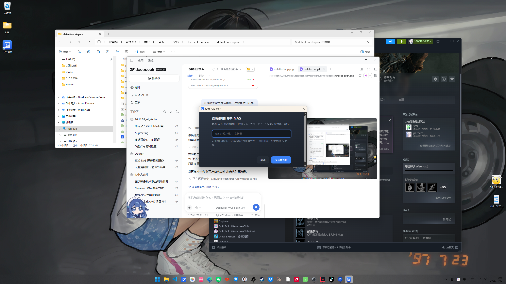

# 使用说明

> 这是第三方做的 Windows 桌面客户端，**不是飞牛官方软件**。它只是把你 NAS 上的相册网页装进一个窗口里，并补上桌面端缺的几个能力。

---

## 1. 安装

1. 到 [Releases](../../releases) 下载 `FnOS-Photos-Setup-<版本>.exe`。
2. 双击运行，它会自己装好并启动（当前用户安装，**不需要管理员权限**）。
3. 装完桌面和开始菜单会有「飞牛相册」快捷方式。

> Windows 可能弹出「已保护你的电脑」——因为安装包没有购买代码签名证书。点「更多信息 → 仍要运行」即可。
> 校验文件是否完整：对照 Release 页面给出的 SHA256。

安装位置：`%LOCALAPPDATA%\Programs\fnos-photos-desktop`

## 2. 第一次启动：填 NAS 地址

第一次打开会看到「连接你的飞牛 NAS」：



- 填 **fnOS 的访问地址**，例如 `http://192.168.1.10:5666`
- 不知道填什么？在浏览器里打开相册，看地址栏：
  - `http://192.168.1.10:5666/p` → 填 `http://192.168.1.10:5666`
  - 末尾的 `/p` 要去掉
- 端口通常是 `5666`（HTTP）或 `5667`（HTTPS）
- 用域名 / 反向代理的，直接填 `https://photos.example.com` 这种

填错了也不要紧：托盘右键 → **设置 NAS 地址…** 随时能改。

## 3. 登录

地址填对后会显示飞牛自己的登录页，**账号密码是你 NAS 的账号**，由你自己输入。

登录成功后，程序会问一次：

> 保存此账号，用于下次自动登录？

- 选 **保存并启用**：下次启动自动填充并提交，省得每次输
- 选 **暂不保存**：什么都不留

密码使用 Windows 的 DPAPI 加密后存在本机 `%APPDATA%\FnOS Photos\login.bin`，只有**当前 Windows 用户**能解密，不会上传到任何地方。

> 忘记密码 / 换账号：`Ctrl+Shift+Delete` → 清除，会退出登录并删掉保存的密码。

## 4. 日常使用

程序常驻托盘，关窗口只是隐藏，不会退出。

| 操作 | 效果 |
| --- | --- |
| `F11` | 全屏 / 退出全屏 |
| `F5` | 刷新页面 |
| `Ctrl+Shift+Delete` | 清除已保存的账号密码并退出登录 |
| 点窗口关闭按钮 | 隐藏到托盘（不退出） |
| 点托盘图标 | 打开窗口 |

托盘右键菜单：

- 打开飞牛相册
- 隐藏到托盘
- 设置 NAS 地址…
- 开机静默启动（勾选后开机自动在后台加载，不弹窗）
- 退出

## 5. 把照片拖出来（重点功能）

这是官方网页做不到的事：**把照片直接拖成文件**，拖到资源管理器、桌面、微信、QQ 都行。

### 单张

在相册里按住一张照片，往目标窗口拖，松手即可。

### 多张

1. **长按**一张照片 → 进入选择模式（卡片出现勾选/高亮）
2. 继续长按或点选其他照片 → 多选
3. 按住其中**任意一张已选照片的中间**往外拖 → 全部一起拖出

### 注意事项

- 拖的时候要按在**图片中间**，按在左上角勾选角标上是点不到图片的
- 第一次拖某几张照片时，会提示「正在取 N 张原图…」——原图要从 NAS 下载，稍等一下；**松手再拖一次**通常就秒出（已缓存）
- 拖出的是**原图**，不是缩略图（走 `/api/v1/stream/p/t/{id}/o/...` 原图通道）
- 文件名规则：`照片_<照片ID>.<扩展名>`，例如 `照片_128528.png`
  飞牛的原图接口不返回原始文件名，所以只能用 ID 命名
- 原图缓存在 `%TEMP%\FnOS-Photos-Drag`，12 小时后自动清理

## 6. 数据与隐私

| 内容 | 位置 |
| --- | --- |
| NAS 地址 | `%APPDATA%\FnOS Photos\config.json` |
| 保存的账号密码 | `%APPDATA%\FnOS Photos\login.bin`（DPAPI 加密） |
| 浏览缓存 / 登录态 | `%APPDATA%\FnOS Photos\Partitions\` |
| 拖拽用原图 | `%TEMP%\FnOS-Photos-Drag\` |

- 所有数据只在本机，**没有遥测、没有第三方服务器**
- 拖拽时照片从你的 NAS 直接下载到本机临时目录

## 7. 卸载

- 设置 → 应用 → 「飞牛相册（非官方）」→ 卸载
- 或运行 `%LOCALAPPDATA%\Programs\fnos-photos-desktop\Uninstall FnOS Photos.exe`

默认**保留** `%APPDATA%\FnOS Photos`（重装后不用重新登录）。想彻底清干净，卸载后手动删掉这个目录即可。

## 8. 常见问题

**Q：提示「暂时连不上你的 NAS」**
A：确认电脑和 NAS 在同一网络；地址端口对不对；先用浏览器访问一下同一地址。

**Q：登录页一直转圈 / 白屏**
A：`F5` 刷新；检查 NAS 服务是否正常；如果是自签 HTTPS 证书，Electron 会拦，可先用 HTTP 地址。

**Q：拖照片没反应**
A：① 按在图片正文而不是角标；② 看是否有「正在取原图」提示，稍等再拖；③ 确认照片不是视频（视频暂不支持拖出）。

**Q：拖出来的是缩略图 / 很小**
A：正常情况拖的是原图。如果你拖的是「预览大图」之外的缩略图元素，仍会按原图通道下载；若发现文件偏小，请反馈照片 ID。

**Q：飞牛升级后拖拽失效**
A：本工具依赖相册网页的接口和 DOM 结构（原图流地址、卡片选中样式类），飞牛改版可能失效。到 Issues 反馈，一般改一处选择器即可。

**Q：开机自启没生效**
A：托盘菜单勾选「开机静默启动」；若被安全软件拦截，把本程序加入信任。

**Q：能拖视频吗**
A：暂不支持，只处理图片。

## 9. 从源码运行

```bash
git clone https://github.com/Archettee/fnos-photos-desktop.git
cd fnos-photos-desktop
npm install
npm start        # 开发运行
npm run dist     # 打包 NSIS 安装包到 dist/
```

需要 Node.js 20+。

> 如果构建目录位于带 Low 完整性标签的目录下（某些沙箱环境），安装包会继承该标签导致装不上。用 `scripts/release.ps1` 把产物复制到普通目录再分发，脚本会顺便校验哈希和完整性标签。
